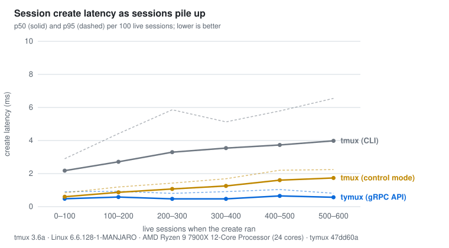
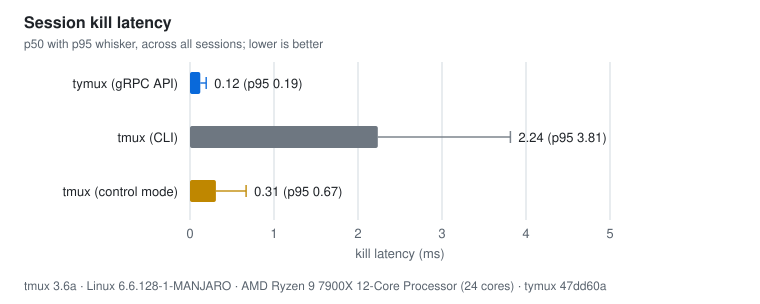
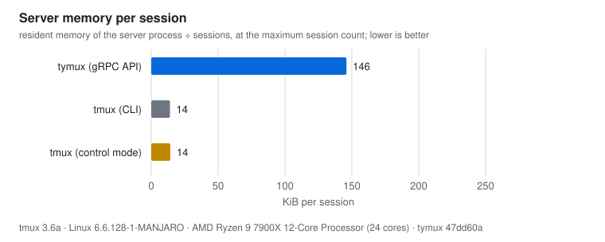

# Benchmarks: tymux vs tmux







The numbers come from one run on one workstation (see the footer of each
chart for the CPU, kernel and commit). They are a snapshot, not a guarantee:
run-to-run variation on the same machine is real (tymux kill p50 has measured
0.09–0.14 ms across runs).

## Reproduce

```sh
scripts/bench.sh --out docs/benchmarks/results.json   # needs tmux, Go and cargo
scripts/render_bench.py                               # regenerates the SVGs and table
scripts/bench.sh --quick                              # 100-session smoke run, prints a table only
```

## What is measured

For each backend the harness starts a fresh, isolated server, creates 600
sessions one after another, then kills them all one after another.

| Backend | How it talks to the server |
|---|---|
| tymux (gRPC API) | one persistent gRPC client over the Unix socket |
| tmux (CLI) | one `tmux` process per command (`new-session -d`, `kill-session`) |
| tmux (control mode) | one persistent `tmux -C` connection; commands as lines |

- **Create latency** is bucketed by how many sessions were already alive, so the
  charts show scaling, not just an average.
- **Kill latency** is across all 600 kills.
- **Memory** is the server process's resident memory (`VmRSS`) at 600 sessions,
  divided by 600. It includes the server's fixed overhead, so it overstates
  the true per-session cost; at 100 sessions the same measure reads higher
  for both servers.

Every session runs `/bin/cat` (blocks on the pty; no shell startup in the
numbers) at 80×24. tmux runs with `-f /dev/null` on a private socket; tymuxd
runs with private `XDG_*` directories. Neither touches your real servers.

## Caveats

- **tymux has no CLI row for create.** `tymux new` always attaches, so a
  CLI-to-CLI create comparison isn't possible yet.
- **The API vs CLI rows answer different questions.** The persistent-connection
  rows (tymux gRPC, tmux control mode) are the like-for-like pair; the tmux CLI
  row is what a script that shells out pays.
- **Linux only** for the memory number (`/proc`). Create and kill run anywhere
  both tools do, but the published numbers are from Linux.
- **Not covered yet:** keystroke-to-echo latency, screen reads, listing at scale,
  reconnect/resume, daemon cold start.
- **tymux uses more memory** (about 146 KiB vs 14 KiB per session at 600).
  The cause hasn't been profiled; each pane has its own reader thread and
  scrollback buffers, which are the first suspects.
