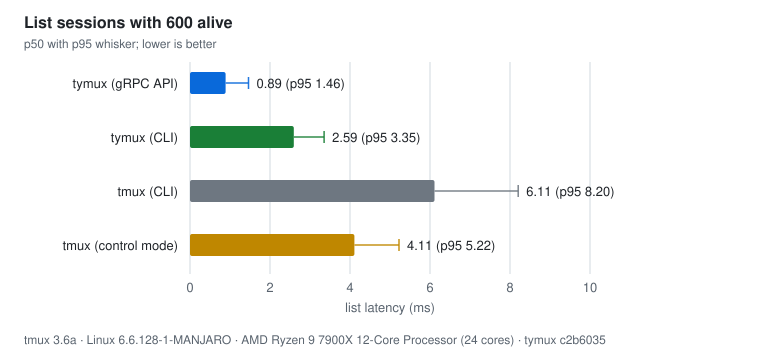
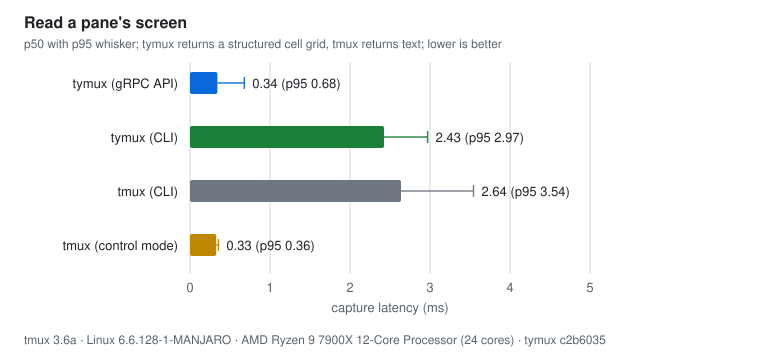
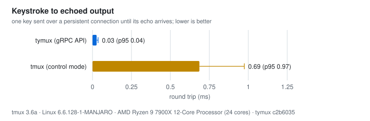
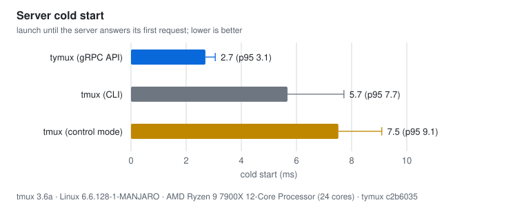
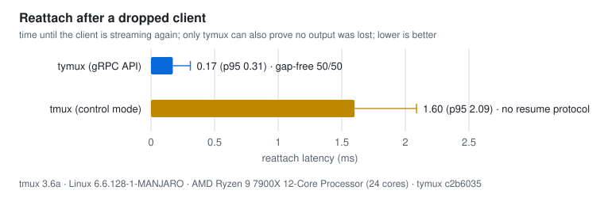

# Benchmarks: tymux vs tmux

Every chart and table here is generated from [`results.json`](results.json).
They are one run on one workstation (each chart's footer names the CPU, kernel
and commit), not a guarantee. Run-to-run variation on the same machine is
real, and a busy machine skews it: re-run on a quiet one before publishing.













## Reproduce

```sh
scripts/bench.sh --out docs/benchmarks/results.json   # needs tmux, Go and cargo
cargo run -p tymux-bench -- render                    # regenerates SVGs, table and the README block
cargo run -p tymux-bench -- render --check            # fails if they are stale (CI runs this)
cargo run -p tymux-bench -- gate                      # fails if results stop backing the README's claims
scripts/bench.sh --quick                              # 100-session smoke run, prints a table only
```

## What is measured

Each backend gets a fresh, isolated server. tmux uses `-f /dev/null` on a
private socket; tymuxd uses private `XDG_*` directories. Neither touches your
real servers. Sessions run `/bin/cat` (blocks on the pty, so no shell startup
in the numbers) at 80×24.

| Backend | How it talks to the server |
|---|---|
| tymux (gRPC API) | one persistent gRPC client over the Unix socket |
| tymux (CLI) | one `tymux` process per command (`new -d`, `kill`, `ls`, `capture`) |
| tmux (CLI) | one `tmux` process per command |
| tmux (control mode) | one persistent `tmux -C` connection; commands as lines |

Compare like with like: the API against control mode (both persistent), the
CLI against the CLI (both pay process startup).

| Scenario | Definition |
|---|---|
| Create | per bucket of live sessions, so the chart shows scaling |
| Kill | all sessions, one after another |
| List | listing with the maximum number of sessions alive (30 samples) |
| Capture | reading session 0's screen at the maximum session count (100 samples) |
| Keystroke echo | one key sent over a persistent connection until its echo arrives (200 samples); persistent-connection rows only |
| Cold start | server launch until its first request is answered (20 launches). For tmux that is the first `new-session`; for control mode it also includes attaching the control client |
| Reattach | drop the client and get it streaming again (50 reattaches). tymux resumes from its last seen output sequence number and reports how many resumes were provably gap-free; tmux has no resume protocol, so no such number exists for it |
| Memory | server RSS at the maximum session count ÷ sessions; rows sharing another row's server omit it |

## Caveats

- **Capture is not the same work.** tymux returns a structured grid of cells
  with attributes; tmux returns text. At low session counts tmux's capture
  over an open control-mode connection is several times faster than tymux's
  gRPC call.
- **Memory is a single reading.** It includes the server's fixed overhead, so
  it overstates the per-session cost.
- **CLI against CLI is close on capture.** The tymux CLI is ahead on create, kill
  and list, but its capture (2.43 ms) is within noise of tmux's (2.64 ms): both
  are dominated by process startup.
- **tymux uses more memory** (about 146 KiB vs 14 KiB per session at 600). The
  cause hasn't been profiled; each pane has its own reader thread and
  scrollback buffers, which are the first suspects.
- **Linux only** for the memory number (`/proc`).

## CI

`cargo run -p tymux-bench -- gate` encodes the README's claims as ratios: the
tymux API must beat tmux's CLI on create, kill, capture and cold start, and
every other pair has a generous tripwire (8–10×). Rules are ratios with wide
margins, not absolute times or small ratios, because a busy machine moves
those far more than a real regression moves a multiple. The published
`results.json` is only regenerated by hand.
